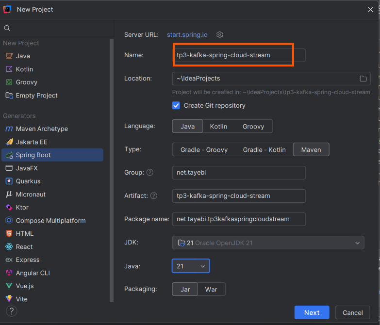
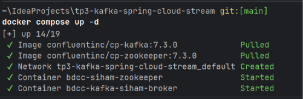
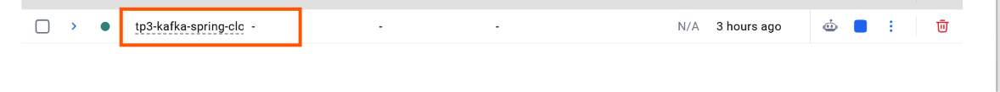
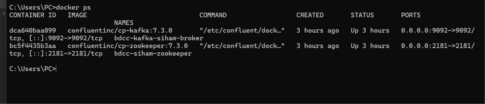
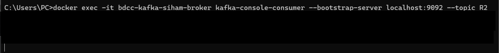
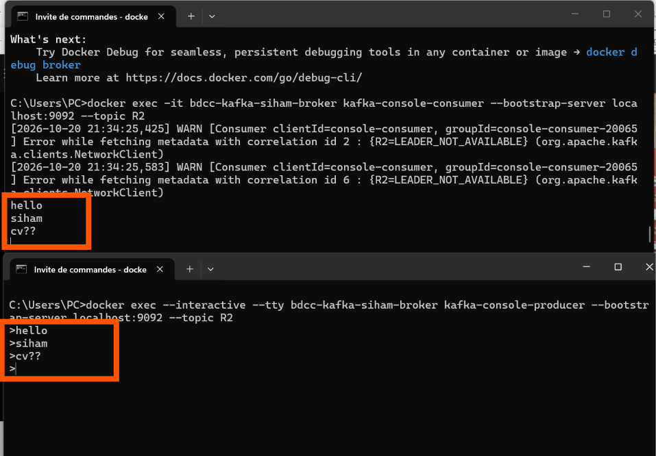
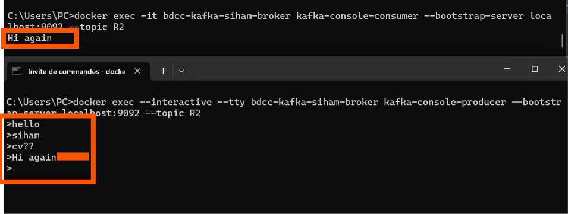
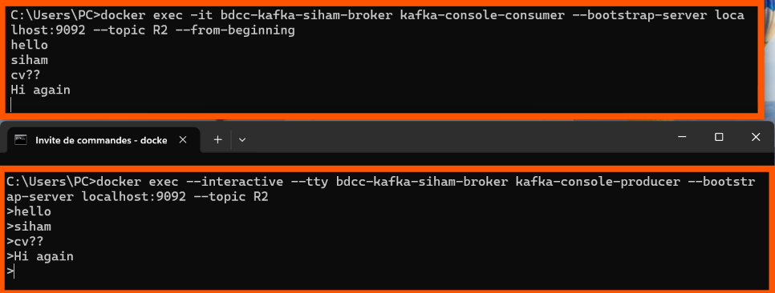
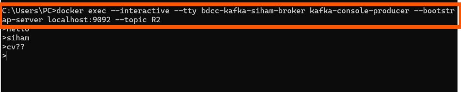
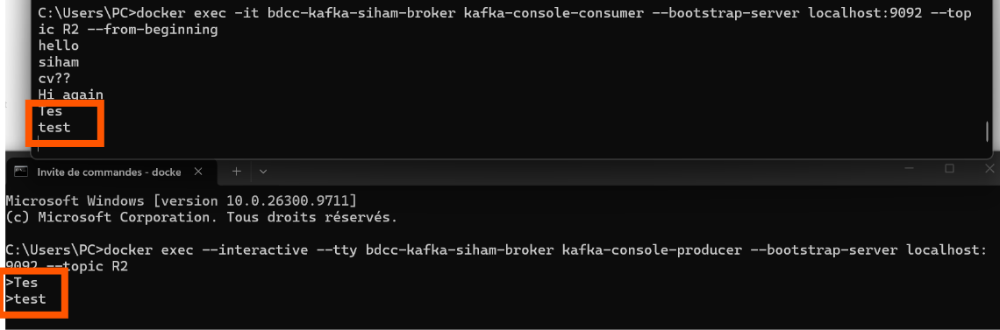

# Compte rendu — TP Event-Driven Architecture avec Kafka, Spring Cloud Stream et Kafka Streams

**Nom / Prénom :** SIHAM TAYEBI
**Filière / Groupe :** BDCCII
**Module :** Architectures pilotées par les événements (Event-Driven Architecture)
**Date :** 20/10/2026

---

## 1. Objectif du TP

Dans ce TP, j'ai mis en place une chaîne complète de traitement d'événements en temps réel :

1. démarrer un broker **Kafka** (avec et sans Docker) et le tester en ligne de commande ;
2. développer avec **Spring Cloud Stream** un *producer* (REST), un *consumer* et un *supplier* ;
3. faire du **Real Time Stream Processing** avec **Kafka Streams** ;
4. afficher les résultats en temps réel dans une **page web**.

Les événements manipulés sont des `PageEvent` : chacun est défini par le **nom de la page**, l'**utilisateur** qui l'a visitée, la **date** de visite et la **durée** de visite (en ms). Je travaille avec deux pages (`P1`, `P2`) et deux utilisateurs (`U1`, `U2`).

## 2. Architecture réalisée

```
Navigateur ──GET /publish──► REST Controller ──StreamBridge──► Topic T2 ──► Consumer (affiche l'événement)

Supplier (1 événement / 200 ms) ──► Topic T3 ──► Kafka Streams (filter, map, groupBy, window 5 s, count)
                                                        │
                                                        ├──► Topic T4 (résultat)
                                                        └──► State store "count-store"
                                                                   │
Page index.html ◄──SSE (1 fois/s)── GET /analytics ◄───────────────┘
```

| Topic | Rôle |
|-------|------|
| `T1` | Test avec `kafka-console-producer` / `kafka-console-consumer` |
| `T2` | Messages publiés par le REST Controller, lus par le Consumer Spring |
| `T3` | Flux continu produit par le Supplier |
| `T4` | Résultat du traitement Kafka Streams (nombre de visites par page) |

---

## 3. Partie 1 — Kafka sans Docker

Étapes réalisées :

1. Téléchargement et décompression de Kafka.
2. Démarrage de **Zookeeper**, puis du **broker Kafka** (sous Windows, scripts `.bat` du dossier `bin\windows` ; sous Linux/macOS, scripts `.sh` du dossier `bin`).
3. Test avec le producer et le consumer en console.
On cree le proejt :

je cree fich docker-compose:

services:
zookeeper:
image: confluentinc/cp-zookeeper:7.3.0
container_name: bdcc-siham-zookeeper
environment:
ZOOKEEPER_CLIENT_PORT: 2181
ZOOKEEPER_TICK_TIME: 2000
ports:
- "2181:2181"

broker:
image: confluentinc/cp-kafka:7.3.0
container_name: bdcc-kafka-siham-broker
depends_on:
- zookeeper
ports:
- "9092:9092"
environment:
KAFKA_BROKER_ID: 1
KAFKA_ZOOKEEPER_CONNECT: zookeeper:2181
KAFKA_LISTENER_SECURITY_PROTOCOL_MAP: PLAINTEXT:PLAINTEXT,PLAINTEXT_INTERNAL:PLAINTEXT
KAFKA_ADVERTISED_LISTENERS: PLAINTEXT://localhost:9092,PLAINTEXT_INTERNAL://broker:29092
KAFKA_LISTENERS: PLAINTEXT://0.0.0.0:9092,PLAINTEXT_INTERNAL://0.0.0.0:29092
KAFKA_INTER_BROKER_LISTENER_NAME: PLAINTEXT_INTERNAL
KAFKA_OFFSETS_TOPIC_REPLICATION_FACTOR: 1
KAFKA_TRANSACTION_STATE_LOG_MIN_ISR: 1
KAFKA_TRANSACTION_STATE_LOG_REPLICATION_FACTOR: 1
d
- on lance nos conteneurs:
- via la cmd docker compose up -d 
- 
- et voila dans docker nore conteneur

```bash
# Zookeeper
bin\windows\zookeeper-server-start.bat config\zookeeper.properties

# Broker Kafka
bin\windows\kafka-server-start.bat config\server.properties

# Consumer (terminal 1)
bin\windows\kafka-console-consumer.bat --bootstrap-server localhost:9092 --topic T1

# Producer (terminal 2)
bin\windows\kafka-console-producer.bat --bootstrap-server localhost:9092 --topic T1
```

> 📸 **Capture à insérer :** les deux terminaux (producer qui envoie "hello", consumer qui le reçoit).

---

## 4. Partie 2 — Kafka avec Docker

### 4.1 Fichier `docker-compose.yml`

J'ai créé à la racine du projet un fichier `docker-compose.yml` démarrant deux conteneurs : `bdcc-zookeeper` et `bdcc-kafka-broker` (port 9092 exposé). Le broker dépend de Zookeeper.

```yaml
services:
  zookeeper:
    image: confluentinc/cp-zookeeper:7.4.0
    container_name: bdcc-zookeeper
    environment:
      ZOOKEEPER_CLIENT_PORT: 2181
      ZOOKEEPER_TICK_TIME: 2000

  broker:
    image: confluentinc/cp-kafka:7.4.0
    container_name: bdcc-kafka-broker
    ports:
      - "9092:9092"
    depends_on:
      - zookeeper
    environment:
      KAFKA_BROKER_ID: 1
      KAFKA_ZOOKEEPER_CONNECT: zookeeper:2181
      KAFKA_LISTENER_SECURITY_PROTOCOL_MAP: PLAINTEXT:PLAINTEXT,PLAINTEXT_INTERNAL:PLAINTEXT
      KAFKA_ADVERTISED_LISTENERS: PLAINTEXT://localhost:9092,PLAINTEXT_INTERNAL://broker:29092
      KAFKA_OFFSETS_TOPIC_REPLICATION_FACTOR: 1
      KAFKA_TRANSACTION_STATE_LOG_MIN_ISR: 1
      KAFKA_TRANSACTION_STATE_LOG_REPLICATION_FACTOR: 1
```

### 4.2 Démarrage et vérification

```bash
docker compose up -d     # démarre zookeeper + broker (télécharge les images au 1er lancement)
docker ps                # vérifie que bdcc-zookeeper et bdcc-kafka-broker tournent
```


### 4.3 Test avec les outils console (dans le conteneur)

```bash
# Consumer sur le topic T1
Consommer les messages du topic R2
docker exec -it bdcc-kafka-broker kafka-console-consumer --bootstrap-server localhost:9092 --topic R2

. Produire des messages dans le topic R2
> 
> 
> 
> si jarrete consumer e le reprend je vais voir aque les msg nv 
> 
pour les recevoir des beginnign on fiat
docker exec -it bdcc-kafka-siham-broker kafka-console-consumer --bootstrap-server localhost:9092 --topic R2 --from-beginning

# Producer sur le topic T1 (autre terminal)
docker exec -it bdcc-kafka-broker kafka-console-producer --bootstrap-server localhost:9092 --topic R2

# Relire tous les messages depuis le début du topic
docker exec -it bdcc-kafka-broker kafka-console-consumer --bootstrap-server localhost:9092 --topic T1 --from-beginning

Consommer les messages du topic R66 avec les clés
docker exec --interactive --tty bdcc-kafka-siham-broker kafka-console-consumer --bootstrap-server localhost:9092 --topic R66 --property print.key=true --property print.value=true --property key.deserializer=org.apache.kafka.common.serialization.StringDeserializer --property value.deserializer=org.apache.kafka.common.serialization.LongDeserializer


on ls tt lis 
docker exec --interactive --tty bdcc-kafka-siham-broker kafka-topics --bootstrap-server localhost:9092 --list
img_10.png
```

**Ce que j'ai observé :**
- Le message tapé dans le producer apparaît dans le consumer avec un **léger décalage**, car le consumer fonctionne par **polling** (environ 1 s).
- Sans option, le consumer ne reçoit que les **nouveaux** messages ; avec `--from-beginning`, il relit tout l'historique du topic.

> 📸 **Captures à insérer :** `docker ps`, puis producer/consumer en action.
> 
> 
> 
> si jarrete consumer e le reprend je vais voir aque les msg nv 
> 
---

## 5. Partie 3 — Spring Cloud Stream + Kafka Streams

### 5.1 Création du projet

Projet **Maven**, **Java 21**, créé avec Spring Initializr dans IntelliJ. Dépendances :

- Spring Web
- Lombok (optionnel)
- Spring for Apache Kafka
- Spring for Apache Kafka Streams
- Spring Cloud Stream
- `spring-cloud-stream-binder-kafka` et `spring-cloud-stream-binder-kafka-streams`

> **À retenir :** Spring Cloud Stream rend le code **indépendant du broker** (Kafka, RabbitMQ, etc.). Seul le *binder* change.

### 5.2 L'événement `PageEvent`

```java
public record PageEvent(String name, String user, Date date, long duration) {}
```

### 5.3 Service Producer : REST Controller

La méthode `publish` crée un `PageEvent` aléatoire (utilisateur U1 ou U2 avec 50 % de chance chacun, durée aléatoire) et l'envoie dans le topic passé en paramètre grâce à `StreamBridge`.

```java
@RestController
public class PageEventController {

    @Autowired
    private StreamBridge streamBridge;

    @GetMapping("/publish")
    public PageEvent publish(String name, String topic) {
        PageEvent pageEvent = new PageEvent(
                name,
                Math.random() > 0.5 ? "U1" : "U2",
                new Date(),
                10 + new Random().nextInt(10000));
        streamBridge.send(topic, pageEvent);
        return pageEvent;
    }
}
```

**Test :** `http://localhost:8080/publish?name=P1&topic=T2`. Le JSON de l'événement s'affiche dans le navigateur et le message apparaît dans un `kafka-console-consumer` lancé sur `T2`.

> 📸 **Capture à insérer :** navigateur (JSON) + consumer console sur T2.

### 5.4 Service Consumer

Un *consumer* est une fonction avec une entrée et **sans sortie**. Elle doit être déclarée comme `@Bean`.

```java
@Component
public class PageEventHandler {

    @Bean
    public Consumer<PageEvent> pageEventConsumer() {
        return input -> {
            System.out.println("*************");
            System.out.println(input.toString());
            System.out.println("*************");
        };
    }
}
```

Pour qu'il s'abonne au topic `T2`, j'ai configuré dans `application.properties` la destination du binding (nom du bean + `-in-0`) et déclaré la fonction :

```properties
spring.cloud.function.definition=pageEventConsumer
spring.cloud.stream.bindings.pageEventConsumer-in-0.destination=T2
```

### 5.5 Service Supplier

Un *supplier* est une fonction **sans entrée** qui retourne une valeur. Spring l'appelle automatiquement toutes les secondes par défaut, ce qui permet de **simuler un capteur** qui produit un flux de données.

```java
@Bean
public Supplier<PageEvent> pageEventSupplier() {
    return () -> new PageEvent(
            Math.random() > 0.5 ? "P1" : "P2",
            Math.random() > 0.5 ? "U1" : "U2",
            new Date(),
            10 + new Random().nextInt(10000));
}
```

```properties
spring.cloud.function.definition=pageEventConsumer;pageEventSupplier
spring.cloud.stream.bindings.pageEventSupplier-out-0.destination=T3
# Par défaut 1000 ms ; je l'ai réduit à 200 ms
spring.cloud.stream.bindings.pageEventSupplier-out-0.producer.poller.fixed-delay=200
```

**Vérification :** un consumer console sur `T3` affiche un message toutes les 200 ms.

### 5.6 Kafka Streams : Real Time Stream Processing

Une `Function<KStream<…>, KStream<…>>` a **une entrée et une sortie** : elle lit un flux dans un topic, calcule en temps réel, et publie le résultat dans un autre topic.

Pipeline que j'ai écrit :

1. `filter` : garder uniquement les visites dont la durée est supérieure à 100 ms ;
2. `map` : transformer en (clé = nom de la page, valeur = durée) ;
3. `groupBy` : regrouper par page (équivalent du `GROUP BY` en SQL) ;
4. `windowedBy` : fenêtre glissante de **5 secondes** ;
5. `count` : compter les visites, stockées dans un *state store* nommé `count-store` ;
6. `toStream` + `map` : retransformer en flux (clé = nom de la page, valeur = nombre de visites).

```java
@Bean
public Function<KStream<String, PageEvent>, KStream<String, Long>> kStreamFunction() {
    return input -> input
            .filter((k, v) -> v.duration() > 100)
            .map((k, v) -> new KeyValue<>(v.name(), v.duration()))
            .groupBy((k, v) -> k, Grouped.with(Serdes.String(), Serdes.Long()))
            .windowedBy(TimeWindows.ofSizeWithNoGrace(Duration.ofSeconds(5)))
            .count(Materialized.as("count-store"))
            .toStream()
            .map((k, v) -> new KeyValue<>(k.key(), v));
}
```

```properties
spring.cloud.function.definition=pageEventConsumer;pageEventSupplier;kStreamFunction
spring.cloud.stream.bindings.kStreamFunction-in-0.destination=T3
spring.cloud.stream.bindings.kStreamFunction-out-0.destination=T4
# Intervalle de commit : 1 s au lieu de 30 s par défaut
spring.cloud.stream.kafka.streams.binder.configuration.commit.interval.ms=1000
```

**Visualiser le résultat dans le topic `T4`** (la valeur est un `Long`, d'où les désérialiseurs) :

```bash
docker exec -it bdcc-kafka-broker kafka-console-consumer \
  --bootstrap-server localhost:9092 --topic T4 \
  --property print.key=true --property print.value=true \
  --property key.deserializer=org.apache.kafka.common.serialization.StringDeserializer \
  --property value.deserializer=org.apache.kafka.common.serialization.LongDeserializer
```

> 📸 **Capture à insérer :** consumer console sur T4 avec P1/P2 et leurs compteurs.

**Rappel des 3 types de fonctions :**

| Type | Entrée | Sortie | Rôle dans mon TP |
|------|:------:|:------:|------------------|
| `Supplier` | non | oui | Produit le flux de `PageEvent` (T3) |
| `Consumer` | oui | non | Affiche les événements reçus (T2) |
| `Function` | oui | oui | Kafka Streams : T3 → T4 |

### 5.7 Exposition des résultats : endpoint `/analytics` (Server-Sent Events)

Je lis le *state store* `count-store` avec l'`InteractiveQueryService`, pour les **5 dernières secondes**, et je pousse le résultat vers le frontend **chaque seconde** sous forme de flux `text/event-stream`.

```java
@Autowired
private InteractiveQueryService interactiveQueryService;

@GetMapping(value = "/analytics", produces = MediaType.TEXT_EVENT_STREAM_VALUE)
public Flux<Map<String, Long>> analytics() {
    return Flux.interval(Duration.ofSeconds(1))
            .map(sequence -> {
                Map<String, Long> map = new HashMap<>();
                ReadOnlyWindowStore<String, Long> windowStore =
                        interactiveQueryService.getQueryableStore("count-store", QueryableStoreTypes.windowStore());
                Instant now = Instant.now();
                Instant from = now.minusSeconds(5);
                KeyValueIterator<Windowed<String>, Long> iterator = windowStore.fetchAll(from, now);
                while (iterator.hasNext()) {
                    KeyValue<Windowed<String>, Long> next = iterator.next();
                    map.put(next.key.key(), next.value);
                }
                return map;
            });
}
```

On ne lit donc **pas une base de données** : on interroge un store calculé en continu par Kafka Streams.

### 5.8 Application web temps réel (`static/index.html`)

La page utilise la librairie **Smoothie Charts** (séries temporelles) et un `EventSource` qui s'abonne à `/analytics`. À chaque message reçu, je récupère le compteur de `P1` et `P2` et je l'ajoute à la courbe correspondante.

```html
<!DOCTYPE html>
<html>
<head>
  <meta charset="UTF-8">
  <title>Analytics temps réel</title>
  <script src="https://cdnjs.cloudflare.com/ajax/libs/smoothie/1.36.1/smoothie.min.js"></script>
</head>
<body>
  <h2>Nombre de visites sur les 5 dernières secondes</h2>
  <canvas id="chart2" width="600" height="400"></canvas>

  <script>
    var pages = ["P1", "P2"];
    var colors = ["green", "red"];
    var courbe = [];

    var chart = new SmoothieChart({ tooltip: true });
    chart.streamTo(document.getElementById("chart2"), 500);

    pages.forEach(function (page, i) {
      courbe[i] = new TimeSeries({});
      chart.addTimeSeries(courbe[i], { strokeStyle: colors[i], lineWidth: 2 });
    });

    var source = new EventSource("/analytics");
    source.addEventListener("message", function (event) {
      var data = JSON.parse(event.data);
      pages.forEach(function (page, i) {
        courbe[i].append(new Date().getTime(), data[page]);
      });
    });
  </script>
</body>
</html>
```

**Résultat :** en ouvrant `http://localhost:8080/index.html`, on voit deux courbes (vert = `P1`, rouge = `P2`) qui évoluent en temps réel après environ 30 secondes d'attente initiale.

> 📸 **Capture à insérer :** la page avec les deux courbes.

---

## 6. Difficultés rencontrées et solutions

| Problème | Cause | Solution |
|----------|-------|----------|
| `No such container` avec `docker exec` | Faute de frappe dans le nom du conteneur | Utiliser exactement le nom du `docker-compose.yml` (`bdcc-kafka-broker`) ou l'ID du conteneur |
| Aucun résultat pendant ~30 s au démarrage | Délai de commit par défaut de Kafka Streams | Définir `commit.interval.ms=1000`. Le tout premier calcul reste un peu lent |
| Rien ne s'affiche sur `/analytics` | Fenêtre configurée à **5000 secondes** au lieu de 5 secondes (confusion `ofSeconds` / `ofMillis`) | Utiliser `Duration.ofSeconds(5)` |
| Le consumer de `T4` n'affiche pas de valeur lisible | Clé `String`, valeur `Long` | Ajouter les `key.deserializer` / `value.deserializer` et `print.key=true` |
| Le bean n'est pas pris en compte | Fonction non déclarée | L'ajouter dans `spring.cloud.function.definition` (séparées par `;`) |
| Rien n'est consommé au début | Le consumer ne lit que les nouveaux messages | Ajouter `--from-beginning` |

---

## 7. Ce que j'ai retenu

- **Kafka** est un broker de messages organisé en **topics** ; un producer écrit, un consumer lit en faisant du *polling*.
- **Spring Cloud Stream** permet de produire/consommer sans dépendre du broker, via des beans `Supplier`, `Consumer` et `Function` associés à des *bindings* (`xxx-in-0`, `xxx-out-0`).
- **Kafka Streams** permet de faire de l'analytique **en temps réel** (filtre, map, regroupement, agrégation) et d'utiliser des **fenêtres de temps** pour ne regarder que les dernières secondes ou minutes.
- Un message Kafka est un couple **clé / valeur**, d'où l'importance des types et des sérialiseurs.
- Les résultats peuvent être **poussés vers le frontend** en continu grâce aux **Server-Sent Events**.

## 8. Conclusion

Ce TP m'a permis de construire une chaîne complète d'**architecture pilotée par les événements** : un Supplier simule un capteur, Kafka transporte les messages, Kafka Streams calcule en temps réel le nombre de visites par page sur une fenêtre de 5 secondes, et une page web affiche le résultat en direct. La prochaine séance portera sur les patterns **Event Sourcing** et **CQRS** avec le framework **Axon** et Axon Server.